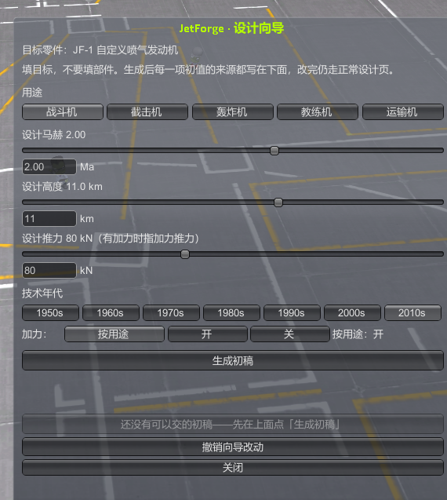
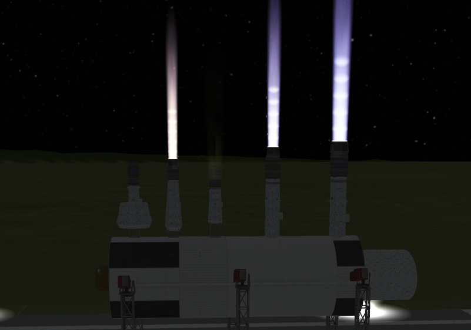

# JetForge

## 中文

### 一句话

按几何画一台喷气发动机，热力性能由流道算出来。

大部分发动机模组给你一条性能曲线，你调一条滑杆，推力跟着变。

JetForge 反过来：它问你级数、叶尖直径、轴的布置、进气道型线，然后从这些数字把气路解出来——
推力、耗油率、各轴转速、喘振与堵塞裕度、发动机长度、干重，都是算出来的，不是你填进去的。

所以「把风扇加大一点会怎样」「涵道比提到 8 会牺牲多少耗油」「涡轮前温到 1700 K 还能转吗」
这三个问题，在这里是同一个问题：改了参数，发动机性能怎么变化。

### 你会得到什么

**发动机设计器**
压气机、涡轮、燃烧室、喷管逐项填，34 条运行状态实时显示出来（温度、转速、喘振、堵塞、轴功率、质量、扭振……），
超过限制会显示超在哪、超多少。

风扇、压气机、涡轮的级数与叶尖直径都可以深度自定义。
并且可以根据设计求解推力-高度-速度热力图

**独立的进气道零件**
进气道是一个**单独的零件**，有自己的编辑面板，不是发动机的一个数字：

* 型线编辑器：每个截面能沿轴向移动、改宽高、改中心偏移；
* **截面倾角**：拖某一段边缘那颗点横着拖，这一圈就斜过来——能做出 F-15 那种斜切进气口；
* 锥尖位置可调、抽气比例、可调中心锥；
* 面板分「设计」和「读数」两页：一页改，一页看全包线读数与装到机上之后的表现。

**减速齿轮风扇（GTF）**
风扇与低压涡轮之间能加齿轮箱，所以 PW1100G 那一级的发动机做得出来。
齿轮箱的重量按风扇功率和传动比给，轴向长度加一节，功率扣掉效率损失；
另外算一阶柔性：静扭角和箱体本体的扭振频率，太软会报警。

**设计向导**
给它用途、设计马赫、高度、推力，它给你一台初稿装到零件上，参数来源一条条写清楚（为什么这么选级数、为什么这么大直径）。

**自适应尾焰**
根据设计和运行状态自动求解的waterfall尾焰

**试车台与剖视**
在试车台上把整台机器从慢车推到最大，看各站位的温度压力流量；剖视能看到内部剖面。

**我的设计库**
存、读、改名、复制、删；每份设计留 5 个历史版本可以回退；
两台发动机并排比十行读数（推力、耗油率、总压比、涵道比、涡轮前温、流量、喘振裕度、长度、干重、造价）；
`UserDesigns/Shared/` 是交换站——把自己的设计放出去、把别人的复制进来。

**撤销**
拖一根滑杆松手算一步，Ctrl+Z 可以退二十步；详细模式和简单模式互相独立，切模式不串。

### 需要什么

* [ **ModuleManager**](https://github.com/sarbian/ModuleManager)
* [ **Waterfall**（尾焰）](https://github.com/KSPModStewards/Waterfall)
* [**RocketSoundEnhancement**](https://github.com/KSPModStewards/RocketSoundEnhancement)

三个都是常见前置，CKAN 里能一起装。

### 怎么装

1. 解压；
2. 把 `GameData/JetForge` 放进你的 `GameData/`；
3. 确认路径是 `GameData/JetForge/JetForge.version`，不是 `GameData/JetForge/JetForge/…`。

装完进游戏，VAB 里搜索 `JetForge` 能看到发动机和进气道两个零件。

### 这一版没有开发的

* **压气机特性图只做显示与读数**，还没真正参与工作点求解（求解器目前按转速给流量）；
* **齿轮箱柔性只到一阶**：齿面接触柔度、轴承游隙、行星均载、齿频激励都没建模；
* **没有 F100 / F110 / CFM56 预设**：没有可靠的公开数据，编一个不如不给；
* **没做 RSS的兼容标定**，装了能用但没人验过；
* 简单模式目前没有齿轮比这个旋钮（0 维模型里齿轮比没有可作用的物理，加了就是假旋钮）。

### 反馈

出问题请附两个日志：

* `KSP.log`
* `GameData/JetForge/JetForge.log`

源码与问题跟踪：https://github.com/AAA-driver-Yang/JetForge

### 更新日志

**1.0.0 — 首个公开版本**

* 参数化发动机设计器，34 条判据实时报警
* 独立进气道零件与型线编辑器（逐截面位置/大小/**倾角**）、锥尖位置、唇口、抽气、可调中心锥
* 设计向导、试车台、剖视
* 减速齿轮风扇：齿轮箱重量与一阶柔性
* 我的设计库：历史版本、并排比读数、交换站
* 撤销栈（详细模式与简单模式）
* 中英双语界面

---

## English

### In one sentence

Draw a jet engine by its geometry; the thermodynamics comes out of the flow path.

Most engine mods hand you a performance curve: move a slider, the thrust changes.

JetForge works the other way around. It asks for stage counts, tip diameters, shaft layout and intake profile,
then solves the gas path from those numbers. Thrust, fuel consumption, spool speeds, surge and choke margins,
engine length and dry mass are all computed, not typed in.

So "what happens if I make the fan a bit bigger", "how much fuel does a bypass ratio of 8 cost me" and
"will it still run at 1700 K turbine inlet temperature" are the same question here:
you change a parameter, and you watch the engine respond.

### What you get

**Engine designer**
Fill in compressor, turbine, combustor and nozzle stage by stage; 34 live readouts update as you type
(temperatures, spool speeds, surge, choke, shaft power, mass, torsional vibration, …).
When you exceed a limit it tells you which one and by how much.

Stage counts and tip diameters for fan, compressor and turbine are all deeply customisable.

**A separate intake part**
The intake is its own part with its own editor, not a number inside the engine:

* profile editor: every section can slide along the axis, change width/height, change its centre offset;
* **section tilt**: drag the edge handle of a section sideways and that ring tilts — this is how you build
  an F-15 style slanted inlet;
* adjustable cone tip position, bleed fraction, and a movable centre cone;
* the panel is split into a Design page and a Readouts page: one to change, one for the full envelope
  and for how it behaves once bolted to an engine.

**Geared turbofan (GTF)**
A gearbox can sit between the fan and the low-pressure turbine, so a PW1100G-class engine is buildable.
Gearbox mass follows fan power and ratio, the nacelle gets longer, and power is charged for the efficiency loss.
First-order compliance is modelled too: static twist angle and the torsional frequency of the housing itself,
and it warns you when the box is too soft.

**Design wizard**
Give it a role, design Mach, altitude and target thrust, and it hands you a first draft applied to the part,
with every parameter's origin spelled out (why this stage count, why this diameter).

**Test cell and cutaway**
Run the whole engine from idle to full dry in the test cell and watch temperatures, pressures and flows at
each station; the cutaway shows the internal sections.

**My designs**
Save, load, rename, copy, delete; each design keeps 5 historical versions you can roll back to.
Compare two engines side by side across ten readouts (thrust, SFC, OPR, bypass ratio, turbine inlet
temperature, mass flow, surge margin, length, dry mass, cost).
`UserDesigns/Shared/` is an exchange folder: drop your design out, pull someone else's in.

**Undo**
Release a slider and that counts as one step; Ctrl+Z walks back twenty. Detailed and simple modes keep
separate stacks, so switching modes never mixes them up.

### Requirements

* **ModuleManager**
* **Waterfall** (plumes)
* **RocketSoundEnhancement** (sound)

All three are common dependencies and install fine together through CKAN.

### Installation

1. Unzip;
2. drop `GameData/JetForge` into your `GameData/`;
3. make sure the path is `GameData/JetForge/JetForge.version`, not `GameData/JetForge/JetForge/…`.

Then load the game and search `JetForge` in the VAB: you should see both the engine and the intake part.

### Not in this release

* **The compressor map is display-only**: it is not yet driving the operating point (the solver sets mass
  flow from spool speed for now);
* **Gearbox compliance is first-order only**: tooth contact compliance, bearing clearance, planetary load
  sharing and gear mesh excitation are not modelled;
* **No F100 / F110 / CFM56 presets**: there is no reliable public data, and a made-up number is worse than none;
* **No RSS calibration**: it runs with RSS installed, but nobody has verified it;
* simple mode has no gear ratio knob (a gear ratio has no physics to act on in a zero-dimensional model,
  so adding one would be a fake switch).

### Feedback

When reporting a problem, please attach both logs:

* `KSP.log`
* `GameData/JetForge/JetForge.log`

Source and issue tracker: https://github.com/AAA-driver-Yang/JetForge

### Changelog

**1.0.0 — first public release**

* Parametric engine designer with 34 live criteria
* Separate intake part with a profile editor (per-section position/size/**tilt**), cone tip position,
  lip, bleed, movable centre cone
* Design wizard, test cell, cutaway
* Geared turbofan: gearbox mass and first-order compliance
* My designs: history, side-by-side comparison, exchange folder
* Undo stacks (detailed and simple modes)
* Chinese/English UI