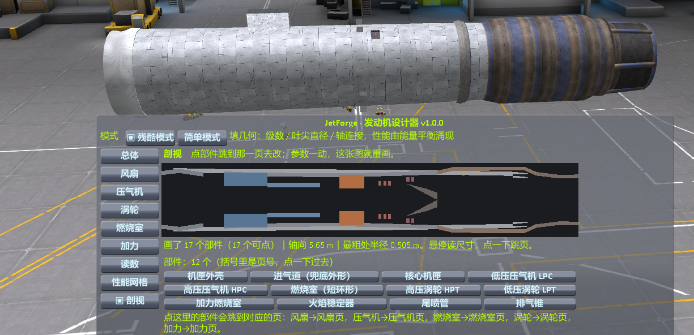
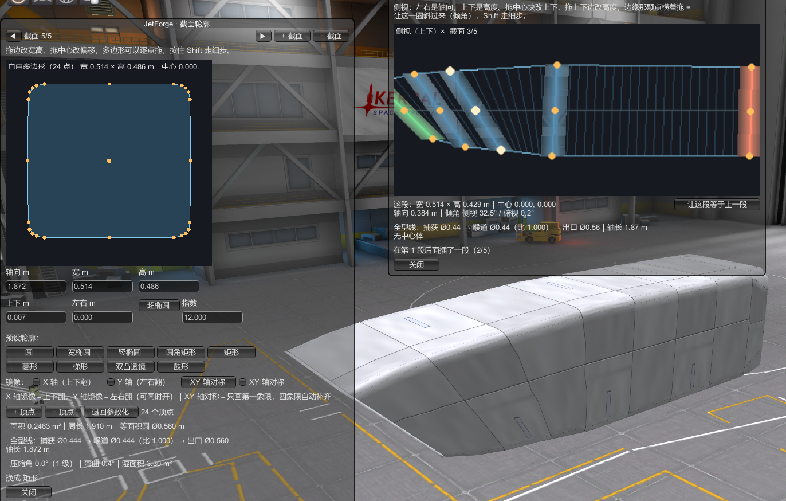
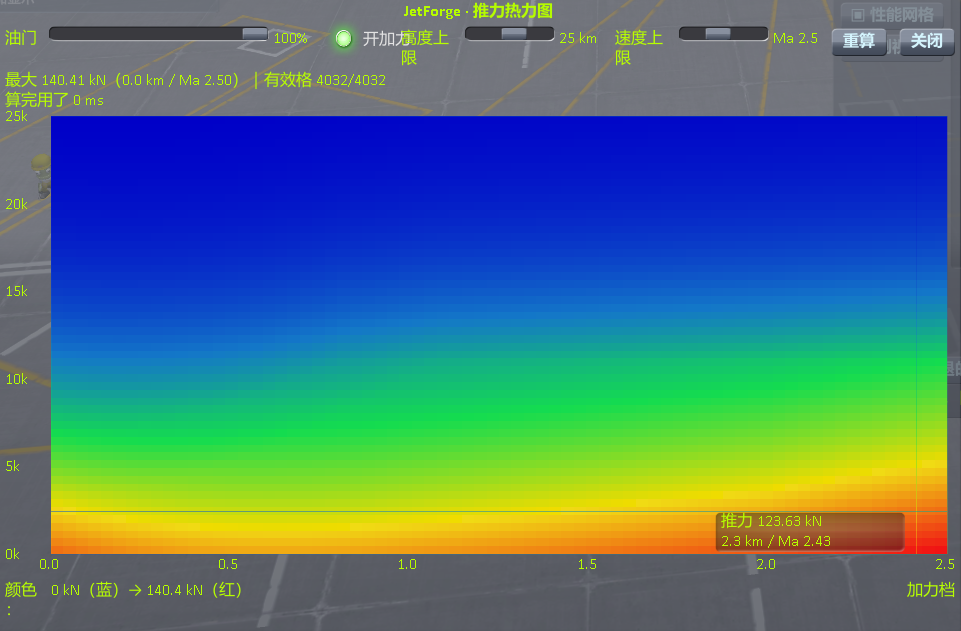

# SpaceDock 介绍（中文底稿）

> 这份是给 SpaceDock「Description」栏的中文底稿。你改完，我再转成双语版（中文在前、英文在后）。
> 两个字段的提醒：\*\*Short description 必须英文\*\*（CKAN 直接拿它当 abstract）；
> 介绍栏里的图片必须用公开网址，写的是 `raw.githubusercontent.com/AAA-driver-Yang/JetForge/main/screenshots/…`，
> 等你把图放进仓库 `screenshots/` 并推上去，这些链接才会显示。

\---

## 一句话

按几何画一台喷气发动机，热力性能由流道算出来。

大部分发动机模组给你一条性能曲线，你调一条滑杆，推力跟着变。

JetForge 反过来：它问你级数、叶尖直径、轴的布置、进气道型线，然后从这些数字把气路解出来——
推力、耗油率、各轴转速、喘振与堵塞裕度、发动机长度、干重，都是算出来的，不是你填进去的。

所以「把风扇加大一点会怎样」「涵道比提到 8 会牺牲多少耗油」「涡轮前温顶到 1700 K 还能转吗」
这三个问题，在这里是同一个问题：改了参数，发动机性能怎么变化。

## 界面

## 你会得到什么

**发动机设计器**
压气机、涡轮、燃烧室、喷管逐项填，34 条运行状态实时显示出来（温度、转速、喘振、堵塞、轴功率、质量、扭振……），
超过限制会显示超在哪、超多少。

风扇、压气机、涡轮的级数与叶尖直径都可以深度自定义。

**独立的进气道零件**
进气道是一个**单独的零件**，有自己的编辑面板，不是发动机的一个数字：

* 型线编辑器：每个截面能沿轴向移动、改宽高、改中心偏移；
* **截面倾角**：拖某一段边缘那颗点横着拖，这一圈就斜过来——能做出 F-15 那种斜切进气口；
* 锥尖位置可调、抽气比例、可调中心锥；
* 面板分「设计」和「读数」两页：一页改，一页看全包线读数与装到机上之后的表现。

**减速齿轮风扇（GTF）**
风扇与低压涡轮之间能加齿轮箱，所以 PW1100G 那一级的发动机做得出来。
齿轮箱的重量按风扇功率和传动比给，轴向长度加一节，功率扣掉效率损失；
另外算一阶柔性：静扭角和箱体本体的扭振频率，太软会报警。

**设计向导**
给它用途、设计马赫、高度、推力，它给你一台初稿装到零件上，参数来源一条条写清楚（为什么这么选级数、为什么这么大直径）。

**试车台与剖视**
在试车台上把整台机器从慢车推到最大，看各站位的温度压力流量；剖视能看到内部剖面。

**我的设计库**
存、读、改名、复制、删；每份设计留 5 个历史版本可以回退；
两台发动机并排比十行读数（推力、耗油率、总压比、涵道比、涡轮前温、流量、喘振裕度、长度、干重、造价）；
`UserDesigns/Shared/` 是交换站——把自己的设计放出去、把别人的复制进来。

**撤销**
拖一根滑杆松手算一步，Ctrl+Z 可以退二十步；详细模式和简单模式互相独立，切模式不串。

## 需要什么

* **ModuleManager**
* **Waterfall**（尾焰）
* **RocketSoundEnhancement**（声音）

三个都是常见前置，CKAN 里能一起装。

## 怎么装

1. 解压；
2. 把 `GameData/JetForge` 放进你的 `GameData/`；
3. 确认路径是 `GameData/JetForge/JetForge.version`，不是 `GameData/JetForge/JetForge/…`。

装完进游戏，VAB 里搜索 `JetForge` 能看到发动机和进气道两个零件。

## 这一版没有开发的

* **压气机特性图只做显示与读数**，还没真正参与工作点求解（求解器目前按转速给流量）；
* **齿轮箱柔性只到一阶**：齿面接触柔度、轴承游隙、行星均载、齿频激励都没建模；
* **没有 F100 / F110 / CFM56 预设**：没有可靠的公开数据，编一个不如不给；
* **没做 RSS的兼容标定**，装了能用但没人验过；
* 简单模式目前没有齿轮比这个旋钮（0 维模型里齿轮比没有可作用的物理，加了就是假旋钮）。

## 反馈

出问题请附两个日志：

* `KSP.log`
* `GameData/JetForge/JetForge.log`

源码与问题跟踪：https://github.com/AAA-driver-Yang/JetForge

\---

## 更新日志

### 1.0.0 — 首个公开版本

* 参数化发动机设计器，34 条判据实时报警
* 独立进气道零件与型线编辑器（逐截面位置/大小/**倾角**）、锥尖位置、唇口、抽气、可调中心锥
* 设计向导、试车台、剖视
* 减速齿轮风扇：齿轮箱重量与一阶柔性
* 我的设计库：历史版本、并排比读数、交换站
* 撤销栈（详细模式与简单模式）
* 中英双语界面

